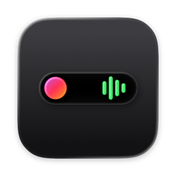

  

<h1 align="center">Atollo</h1>

Il brano di Spotify nella barra dei menu del Mac.

<a href="https://github.com/valerioceniccola/atollo/releases/latest"><b>Scarica Atollo per Mac</b></a> · <a href="https://atollo.hortelab.com">atollo.hortelab.com</a>

---

Atollo mette nella barra dei menu una capsula di vetro scuro con la copertina, il titolo e l'artista di quello che stai ascoltando su Spotify, e un piccolo equalizzatore. Niente finestre da aprire, niente da configurare: c'è finché Spotify è aperto, sparisce quando lo chiudi.

## Cosa fa

- **Il brano sempre a colpo d'occhio.** Copertina, titolo e artista; se il titolo è lungo scorre avanti e indietro.
- **Discreta in pausa.** Quando metti in pausa Atollo si stringe a copertina ed equalizzatore spento.
- **Al suo posto tra le icone.** Sta a sinistra delle altre icone della barra dei menu, con la loro stessa spaziatura, anche a schermo intero.
- **Tasti multimediali solo per Spotify.** Play/pausa, avanti e indietro della tastiera vanno a Spotify, non al primo video aperto nel browser.
- **Equalizzatore del colore giusto.** In automatico prende il colore dello sfondo della scrivania; oppure l'accento di sistema o un colore a scelta.
- **Si aggiorna da solo.** Quando esce una versione nuova, Atollo te la propone con le novità.

## Installazione

1. [Scarica l'ultima versione](https://github.com/valerioceniccola/atollo/releases/latest): è il file `Atollo-….dmg`.
2. Aprilo e trascina **Atollo** nella cartella **Applicazioni**.
3. Apri Atollo: la schermata di benvenuto ti chiede i due permessi che servono.

Servono macOS 26 (o successivo) e l'app Spotify per Mac.

## Come si usa

| Per… | Fai così |
|---|---|
| aprire Spotify | clic su Atollo |
| copiare il link del brano | tasto destro su Atollo › *Copia link del brano* |
| impostazioni | tasto destro su Atollo › *Impostazioni…*, oppure riapri Atollo dal Finder |
| controllare gli aggiornamenti | Impostazioni › *Controlla ora…* |

## Permessi

- **Controllo di Spotify** (Automazione): per leggere il brano in riproduzione e mandargli play/pausa, avanti e indietro.
- **Accessibilità**: per far arrivare i tasti multimediali della tastiera solo a Spotify. Atollo guarda solo quei tasti, mai quello che scrivi.

Atollo non ascolta e non registra l'audio, e non ha server: parla solo con Spotify sul tuo Mac e, per gli aggiornamenti, con questa pagina di GitHub.

## Domande frequenti

**Non vedo Atollo nella barra dei menu.**
Compare solo con Spotify aperto. Se Spotify è aperto, controlla in Impostazioni › Permessi che *Controllo di Spotify* sia concesso.

**I tasti multimediali aprono ancora Apple Music.**
Serve il permesso *Accessibilità*: Impostazioni di Atollo › Permessi › *Concedi*, oppure Impostazioni di Sistema › Privacy e sicurezza › Accessibilità.

**E le AirPods?**
I comandi delle AirPods e delle cuffie Bluetooth vanno già all'app che sta suonando, quindi a Spotify: Atollo non li tocca.

---

Per chi sviluppa: [rilasciare una nuova versione](docs/RELEASING.md). La landing è in `site/` e si pubblica da sola su GitHub Pages a ogni modifica.
